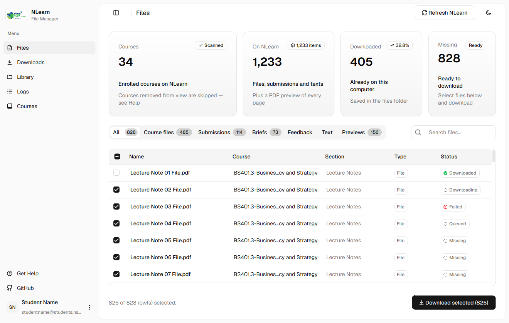
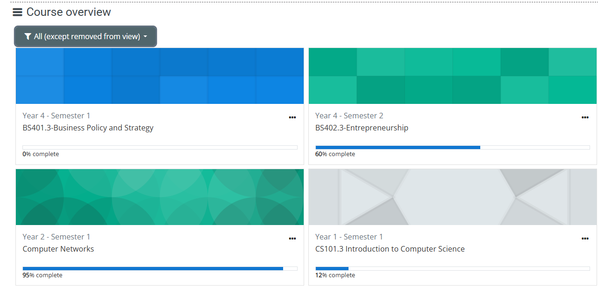
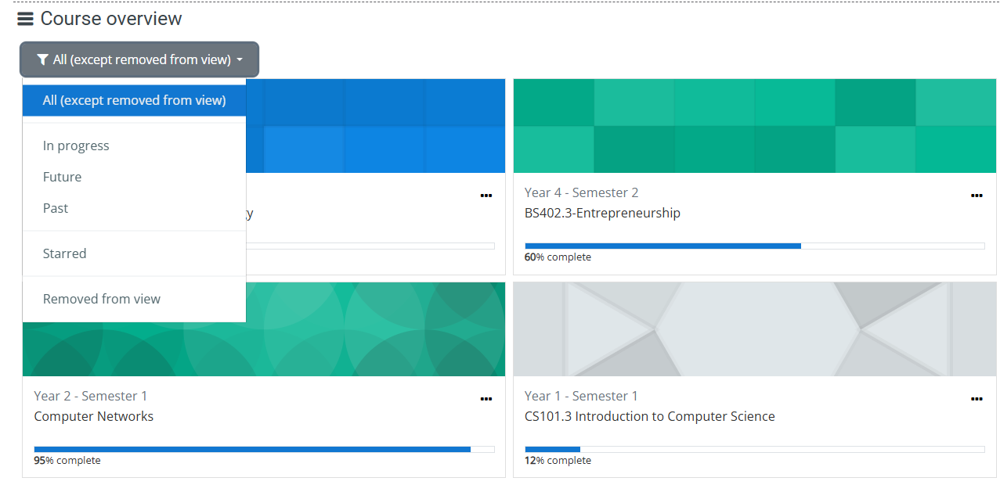
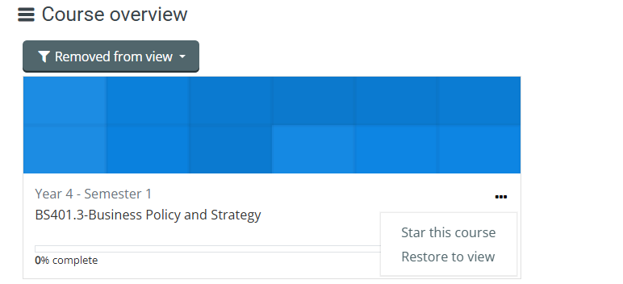
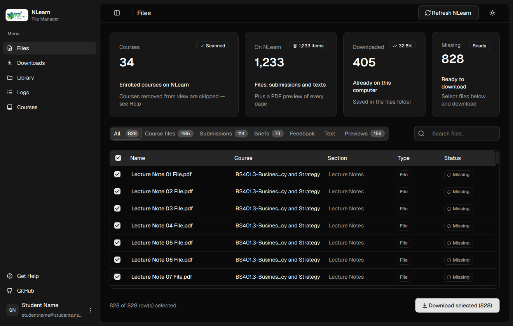

# NLearn File Manager v4

Download everything from NSBM's NLearn to your computer in one go: lecture files, folders, your assignment submissions, assignment briefs, teacher feedback, text from the course pages, and a PDF copy of every page.

**[⬇ Download NLearn File Manager.exe](https://github.com/upekshaip/nlearn-file-manager/releases/latest/download/NLearn.File.Manager.exe)** · [all releases](https://github.com/upekshaip/nlearn-file-manager/releases)

Windows 10/11 (64-bit). Download the one `.exe` file and double-click it. There's nothing to install.



## What it downloads
- **Course files and folders** for every module. Folders are saved as `.zip`.
- **Your assignment submissions**, including folders inside a submission and older attempts.
- **Assignment briefs**: the file attached at the top of an assignment.
- **Teacher feedback files** and feedback comments.
- **Text from NLearn pages** as `.txt` files: announcements and notes on the course page, assignment instructions, and answers you typed in as online text.
- **Links** as `.txt` files: NLearn URL activities (with the real YouTube/Drive/SharePoint address), forums, quizzes, feedback forms and choices.
- **A PDF preview of every page**: `Course page.pdf` for each module and `Assignment page.pdf` for each assignment, exactly as they look on NLearn.

Everything is saved in a **`files`** folder next to the app:
```
files/<module>/
    Course page.pdf
    <section>/<file>
    <section>/Section text.txt
    <section>/<assignment>/
        Assignment page.pdf
        Brief/...
        My Submission/...
        Feedback/...
```

## How to use it
1. **Start the app.** The first start takes a few seconds while it unpacks.
2. **Sign in** with your NSBM student username and password.
   - Tick **Remember me on this computer** to be signed in automatically next time. Your login is then saved in `saved_login.json` next to the app. **Log out**, or **Forget saved login** in the menu under your name, deletes it.
3. **Scan.** The app scans NLearn by itself after you sign in. Press **Refresh NLearn** to scan again.
4. **Choose what to download** on the Files page. Filter by type (course files, submissions, briefs, feedback, text, previews), search, and untick what you don't want.
5. **Download selected.** Files download in parallel; set how many at a time (1–8) on the Downloads page. You can **Stop** at any time and **Retry failed** files.
6. **Open your files** from the **Library** page, or the `files` folder next to the app.

Other pages: **Logs** lists everything downloaded so far, and **Courses** lets you tick courses to skip.

## ⚠ Courses removed from view are not scanned
The app scans the courses NLearn lists under **Dashboard → Course overview → "All (except removed from view)"**. If you removed a course from view on your NLearn dashboard, its modules are skipped. To download everything, restore them first:

**1.** On NLearn, open **Dashboard → Course overview**. The filter shows "All (except removed from view)". These are the courses the app scans.



**2.** Open the filter and choose **Removed from view**.



**3.** For every course there, click **…** → **Restore to view**. Then press **Refresh NLearn** in the app.



## Good to know
- **Windows may warn you** the first time ("Windows protected your PC") because the app isn't signed. Click **More info → Run anyway**.- Light and dark mode: use the sun/moon button at the top right.
- Downloading again later only fetches what is new; files you already have are skipped.



---
Solely coded by upekshaip
